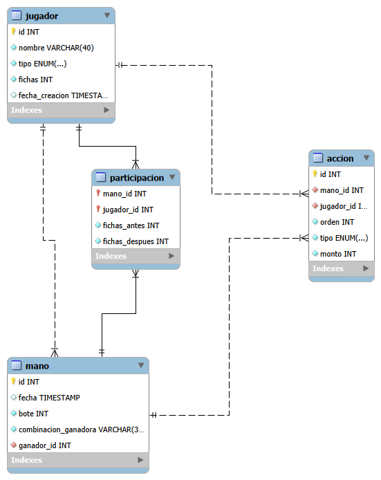

# Póker de Fichas – Proyecto 2 (Programación III, EIF206)

Aplicación de escritorio en JavaFX (Texas Hold'em contra dos bots). En el Proyecto 2 los datos dejan de vivir solo en memoria: se guardan en una base de datos MySQL a la que se accede por JDBC con el patrón DAO.

## Funcionalidades nuevas del Proyecto 2
- **Perfiles de jugador persistentes:** crear, listar, editar y eliminar perfiles de jugador humano (CRUD completo). Al iniciar se elige un perfil y la partida arranca con sus fichas; el saldo se guarda al terminar cada ronda.
- **Historial de manos:** cada ronda terminada se guarda en MySQL (bote, combinación ganadora, ganador, fichas de cada jugador antes y después, y todas las acciones en orden).
- **Estadísticas:** pantalla *Historial y estadísticas* con las manos jugadas, las acciones de la mano seleccionada, el ranking de victorias, el mayor bote y el bot con más victorias.
- **Hilos:** las operaciones con la base de datos (cargar perfiles, guardar fichas, guardar la mano, cargar el historial) se ejecutan en un `Task` con hilo aparte, para que la interfaz no se congele.

## Requisitos
- JDK 21 o superior
- Maven
- MySQL 8 o superior y MySQL Workbench

## Configurar la base de datos
1. Instalar MySQL y Workbench.
2. Abrir `db/schema.sql` en Workbench y ejecutarlo (primer rayo). Crea la base `poker` con sus 4 tablas y los dos bots.
3. Copiar `PokerDeFichas/db.properties.example` como `PokerDeFichas/db.properties` (en la misma carpeta).
4. Cambiar `clave=` por la contraseña de **su** MySQL. Este archivo no se sube a Git.

## Ejecutar
Desde la carpeta `PokerDeFichas` (donde está el `pom.xml`):
```
cd PokerDeFichas
mvn javafx:run
```
Si se corre desde la raíz del repositorio, Maven da el error `No plugin found for prefix 'javafx'`.

## Estructura del repositorio
```
db/
  schema.sql          Creación de la base de datos
  Consultas.sql       Consultas de historial y estadísticas
  diagrama_EER.png    Diagrama entidad-relación
docs/                 Trabajo escrito y manual de usuario (PDF)
PokerDeFichas/
  db.properties.example
  pom.xml
  src/main/java/
    dao/              Acceso a datos: ConexionBD, JugadorDAO, ManoDAO,
                      EstadisticasDAO (interfaces) y sus implementaciones JDBC
    juego/            Lógica de la partida y estrategias de los bots
    model/            Cartas, jugadores, perfiles, manos, resultados
    util/             Validaciones y excepciones
    view/             Interfaz JavaFX (mesa, perfiles, historial)
```

## Modelo de datos


- `jugador`: perfil persistente (nombre único, tipo HUMANO o BOT, fichas).
- `mano`: una ronda terminada (fecha, bote, combinación ganadora, ganador).
- `participacion`: tabla intermedia N:M entre jugador y mano (llave compuesta), con fichas antes y después.
- `accion`: cada jugada de una mano, en orden.

## Reparto del trabajo
| Integrante | Responsabilidad |
|---|---|
| Cristian Coronado Chávez | Base de datos e infraestructura: esquema, diagrama, `ConexionBD`, Maven. Guardado de manos (`ManoDAO`, transacción, hilo aparte). Integración del repositorio |
| Valeria Bahena Mujica | Perfiles de jugador: DAO y CRUD, pantalla, carga en hilo aparte |
| Kenan Joel Solis Brenes | Manual de usuario actualizado y pruebas, guardado de manos poker en base de datos. |
| Sebastián Hincapié Salazar | Historial y estadísticas: consultas y pantalla |

## Bitácora de IA
| Fecha | Integrante | Herramienta | Para qué se usó | Qué sirvió / qué hubo que corregir |
|---|---|---|---|---|
| Oct 2026 | Cristian | Claude | Guía paso a paso para el esquema MySQL, el diagrama EER y la clase `ConexionBD` | Sirvió para entender el patrón DAO y las llaves; hubo que corregir la ruta de `db.properties` y el nombre del módulo del conector (`mysql.connector.j`) |
| Oct 2026 | Cristian | Claude | Escribir `ManoDAO` y `ManoDAOJdbc` (transacción) e integrarlos en `VentanaPrincipal` | Sirvió para guardar la mano completa; hubo que corregir un campo duplicado y convertir la combinación a texto (`.name()`) |
| Oct 2026 | Cristian | Claude | Ayuda con Git (merge, push rechazado) y con Maven en Windows (`mvn javafx:run`) | Sirvió para dejar `main` compilando; hubo que ejecutar Maven dentro de `PokerDeFichas` |
| Nov 2026| Sebastian | Claude | Escribir "EstadisticasDAO" y poder integrarlo al proyecto | Me ayudó a entender los patrones DAO y como integrar código SQL en este tipo de proyectos |
| Oct 2026 | Kenan | Claudio | Guias para conectar la base de datos el proyecto en java. | Me ayudo de manera didactica a entender como aplicar las bases de datos y a ver distintas opciones de integración con el proyecto.|
| | | | | |

*(Valeria, Kenan y Sebastián: agreguen aquí sus propias filas si usaron IA.)*

## Entrega
Domingo 1 de noviembre de 2026.
