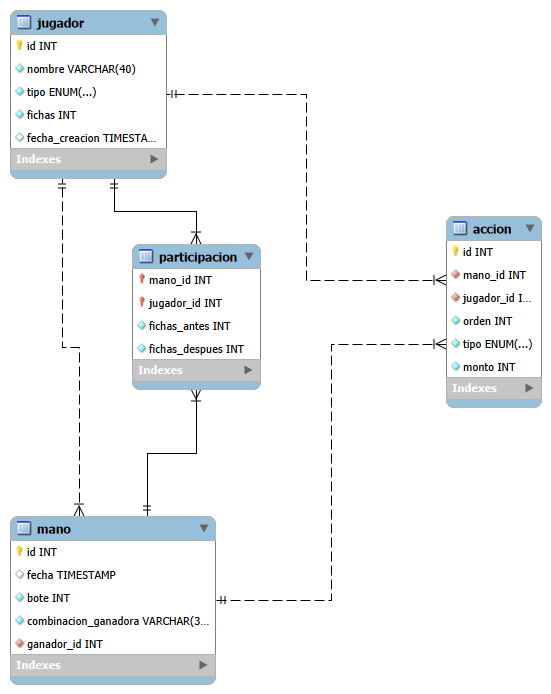

# Póker de Fichas – Proyecto 2 (Programación III, EIF206)

Aplicación de escritorio en JavaFX (Texas Hold'em contra dos bots). En el Proyecto 2 los datos dejan de vivir solo en memoria: se guardan en una base de datos MySQL a la que se accede por JDBC con el patrón DAO.

## Requisitos
- JDK 21 o superior
- Maven
- MySQL 8 o superior y MySQL Workbench

## Configurar la base de datos
1. Instalar MySQL y Workbench.
2. Abrir `db/schema.sql` en Workbench y ejecutarlo (primer rayo). Crea la base `poker` con sus 4 tablas y los dos bots.
3. Copiar `PokerDeFichas/db.properties.example` como `PokerDeFichas/db.properties` (en la misma carpeta).
4. Cambiar `clave=` por la contraseña de **su** MySQL. Este archivo no se sube a Git.

## Ejecutar
```
cd PokerDeFichas
mvn javafx:run
```

## Estructura del repositorio
```
db/
  schema.sql          Creación de la base de datos
  Consultas.sql       Consultas de historial y estadísticas
  diagrama_EER.png    Diagrama entidad-relación
docs/                 Trabajo escrito y manual de usuario (PDF)
PokerDeFichas/
  db.properties.example
  pom.xml
  src/main/java/
    dao/              Acceso a datos (ConexionBD y DAO)
    juego/            Lógica de la partida y estrategias de los bots
    model/            Cartas, jugadores, manos, resultados
    util/             Validaciones y excepciones
    view/             Interfaz JavaFX
```

## Modelo de datos


- `jugador`: perfil persistente (nombre único, tipo HUMANO o BOT, fichas).
- `mano`: una ronda terminada (fecha, bote, combinación ganadora, ganador).
- `participacion`: tabla intermedia N:M entre jugador y mano (llave compuesta), con fichas antes y después.
- `accion`: cada jugada de una mano, en orden.

## Reparto del trabajo
| Integrante | Responsabilidad |
|---|---|
| Cristian Coronado | Base de datos e infraestructura: esquema, diagrama, `ConexionBD`, Maven |
| (nombre) | Perfiles de jugador: DAO y CRUD, pantalla, carga en hilo aparte |
| (nombre) | Guardado de manos: DAO, transacción, hilo aparte |
| (nombre) | Historial y estadísticas: consultas y pantalla |

## Bitácora de IA
| Fecha | Integrante | Herramienta | Para qué se usó | Qué sirvió / qué hubo que corregir |
|---|---|---|---|---|
| | | | | |

## Entrega
Domingo 1 de noviembre.
